<div align="center">


# TT — Terminal Tools

**Estação de trabalho SSH livre e aberta para o técnico de campo, o analista de redes e o sysadmin.**
No seu computador ou acessada pela rede, com usuários, túneis, SFTP e um assistente de IA que **só sugere**.

[](https://github.com/emersoncassis/TT/actions/workflows/ci.yml)
[](LICENSE)


[](CONTRIBUTING.md)

[Início rápido](#início-rápido) · [Telas](#telas) · [Recursos](#recursos) · [Segurança](#segurança) · [Roadmap](#roadmap) · [Como ajudar](#como-ajudar)

<br>

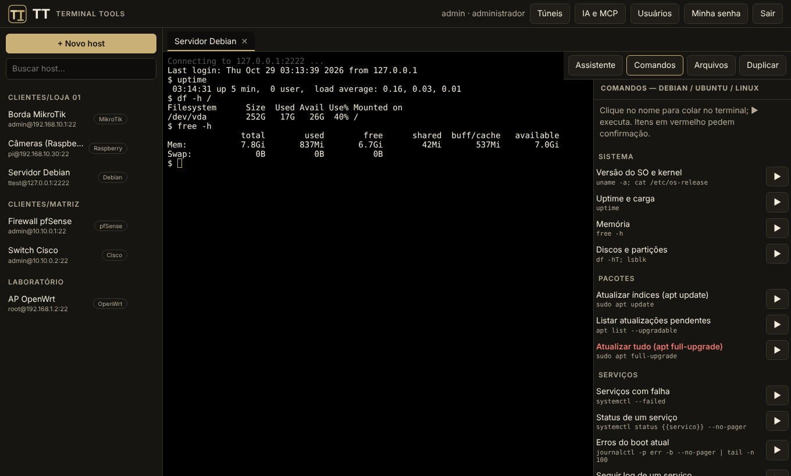

</div>

> [!NOTE]
> **Em pleno desenvolvimento (v0.2).** O que está aqui já funciona, mas ainda falta muita coisa, e **a comunidade é bem-vinda**: testar em equipamentos reais, corrigir comandos, criar perfis, traduzir e implementar o roadmap. Veja [Como ajudar](#como-ajudar).

## Por que o TT

| A dor | O que o TT faz |
|---|---|
| Cada equipamento entra de um jeito: MikroTik quer `+ct` no usuário, Cisco pede `terminal length 0` e `enable`, pfSense cai num menu e você digita `8`. | Conhece essas manhas e faz por você, por **tipo de equipamento**. |
| "Eu esqueço o comando." | Comandos prontos e agrupados (diagnóstico, rede, firewall, backup…), com os perigosos marcados e pedindo confirmação. |
| Senhas e IPs espalhados em planilhas e bloco de notas. | Sessões em pastas, segredos **criptografados**, e acesso pela rede com **usuário e senha** para a equipe, cada um com seus hosts. |
| Preciso acessar de qualquer lugar, mas quem enxerga os equipamentos é a rede interna. | No modo servidor só o TT alcança os equipamentos; o técnico usa o navegador. |
| Ferramentas boas são pagas ou fechadas. | **MIT**: use, modifique, troque a logo, distribua. |

**Para quem:** técnicos de campo e integradores (CFTV, redes, segurança eletrônica), provedores e ISPs pequenos, times de TI, sysadmins, homelabbers e estudantes de redes.

## Início rápido

**Windows, Linux e macOS:** baixe o arquivo da sua plataforma em [Releases](https://github.com/emersoncassis/TT/releases), extraia e dê dois cliques em `tt.exe` (ou rode `tt local`). Abre uma janela de aplicativo já logada; seus dados ficam numa pasta do seu usuário.

Para compilar do código-fonte: [Rust](https://rustup.rs) estável (edição 2024).

```bash
git clone https://github.com/emersoncassis/TT.git
cd TT

cargo run --release -- local                    # uso individual: janela de aplicativo, já logada
# ou
cargo run --release -- serve --bind 127.0.0.1:8443   # modo servidor, acesso por usuário e senha
```

No modo servidor, o **primeiro acesso cria o administrador**, que depois cria os demais usuários. O app desktop empacotado (Tauri) ainda está no [roadmap](#roadmap); por ora o `tt local` já abre como janela de aplicativo.

| Modo | Comando | Para quê |
|---|---|---|
| **Local** | `tt local` | Uso individual. Escuta só em `127.0.0.1`, sem senha (token de uso único). Abre como janela de app (`--tab` para aba normal). |
| **Servidor web** | `tt serve` | O servidor fala SSH com os equipamentos; o painel é acessado pela rede, com usuários. |

## Telas

<table>
<tr>
<td width="50%">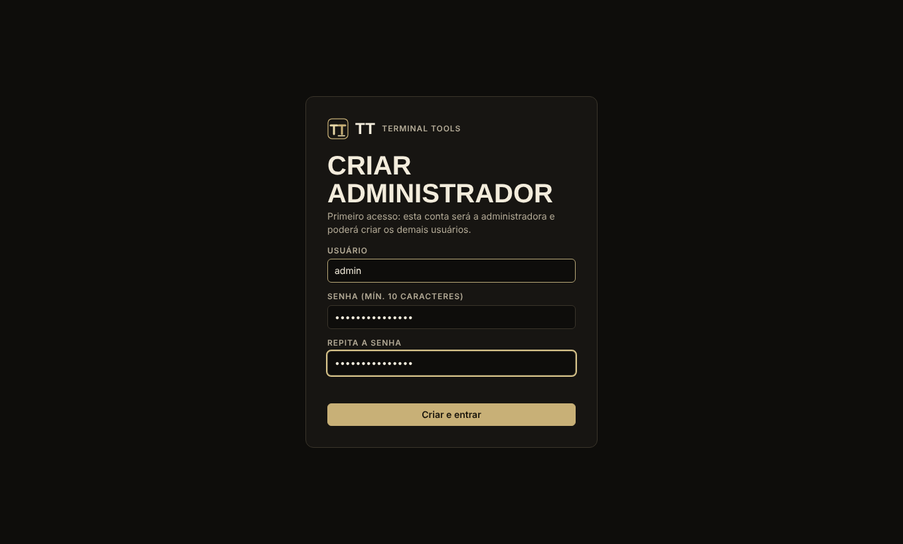<br><b>Primeiro acesso</b>: cria o administrador</td>
<td width="50%">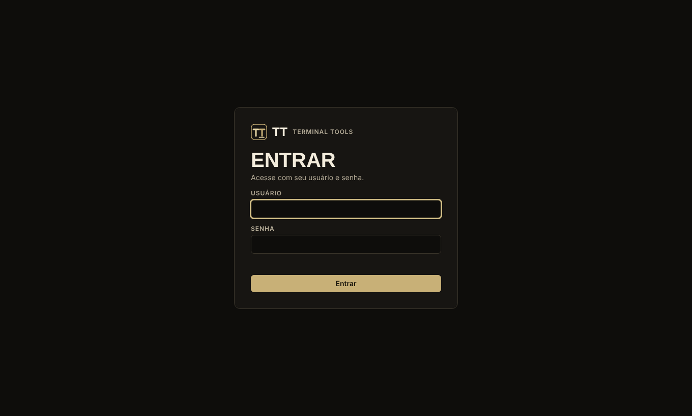<br><b>Login</b> com usuário e senha</td>
</tr>
<tr>
<td>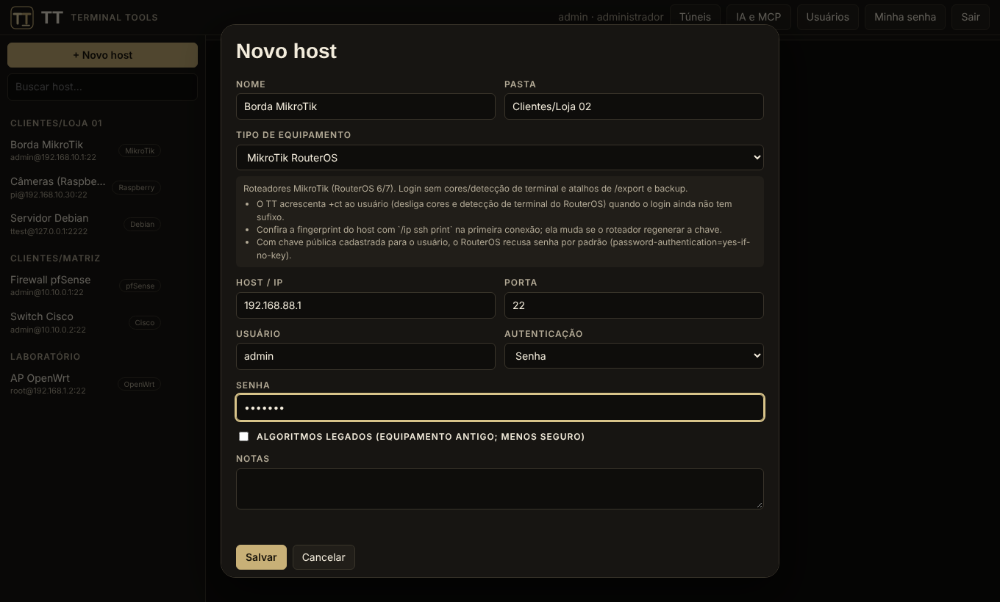<br><b>Cadastro por tipo de equipamento</b>, com avisos específicos</td>
<td>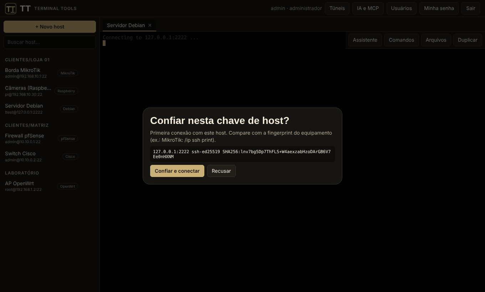<br><b>Chave do host</b>: confiar na primeira vez, alerta forte se mudar</td>
</tr>
<tr>
<td><br><b>Operação</b>: terminal, abas e comandos prontos</td>
<td>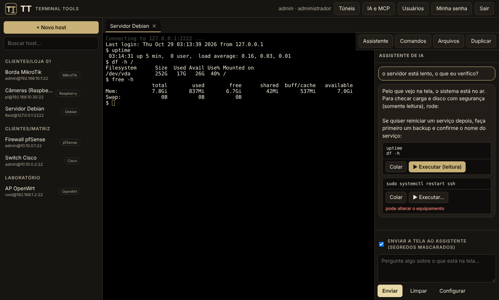<br><b>Assistente de IA</b> sugerindo comandos<sup>*</sup></td>
</tr>
<tr>
<td>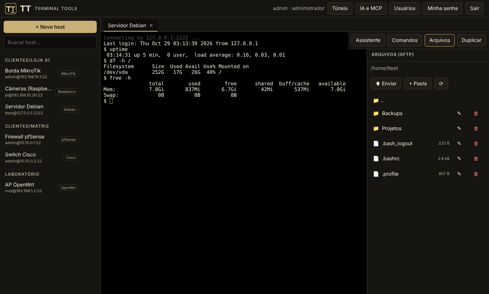<br><b>Arquivos por SFTP</b> ao lado do terminal</td>
<td>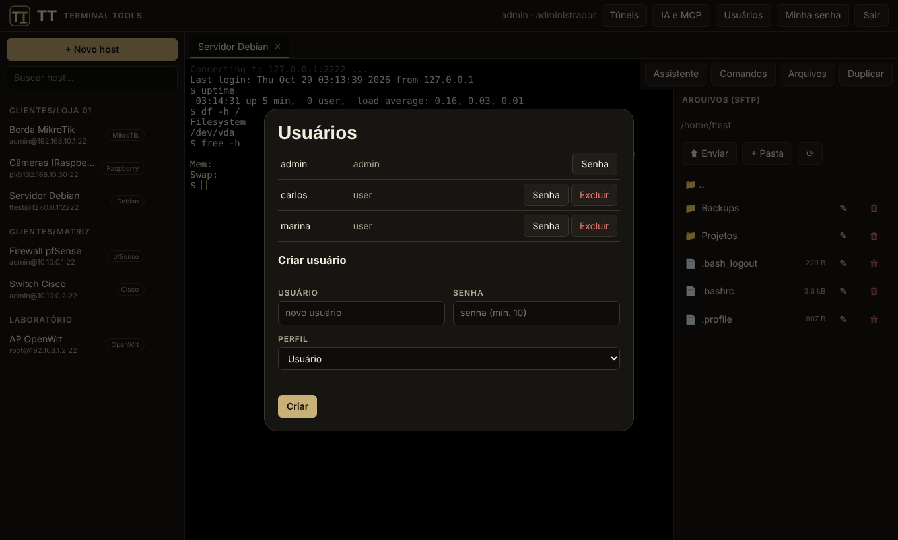<br><b>Gestão de usuários</b> (administrador)</td>
</tr>
<tr>
<td>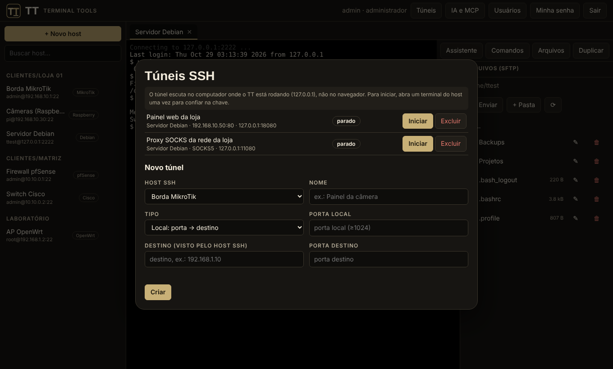<br><b>Túneis SSH</b>: local e SOCKS5</td>
<td>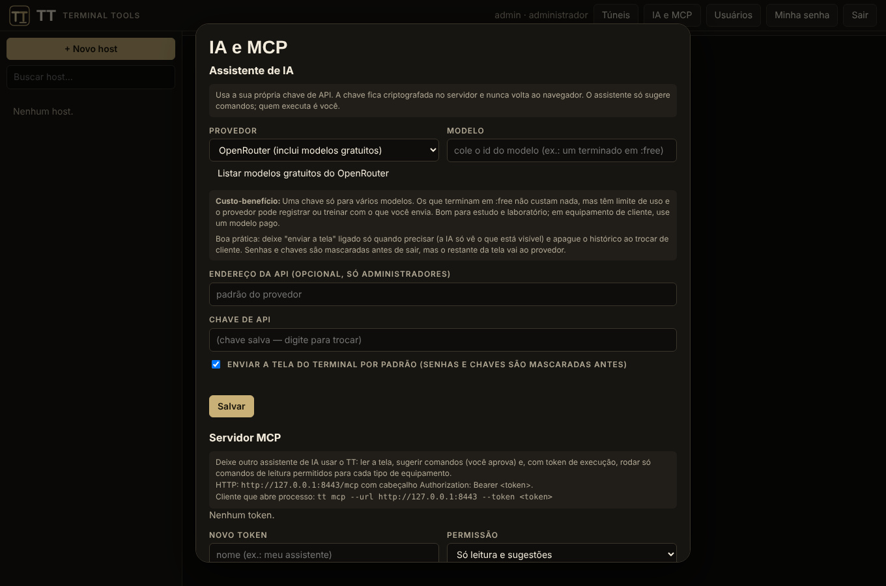<br><b>IA e MCP</b>: chave própria e tokens</td>
</tr>
</table>

<sub>* A resposta do assistente nesse print vem de um modelo simulado, só para ilustrar a tela.</sub>

## Recursos

- **Terminal SSH no navegador** (xterm.js) com abas; login por senha, chave privada e keyboard-interactive.
- **Perfis de equipamento:** Debian/Ubuntu, Raspberry Pi, OpenWrt, pfSense, OPNsense, MikroTik, Cisco IOS/IOS-XE, Juniper Junos, Huawei VRP, NETCONF e genérico. Veja [docs/PLATFORMS.md](docs/PLATFORMS.md).
- **Console NETCONF** (RFC 6241/6242, framing 1.0 e 1.1).
- **SFTP:** listar, enviar, baixar, criar pasta, renomear, excluir.
- **Túneis SSH:** encaminhamento local e proxy **SOCKS5**, com iniciar e parar pelo painel.
- **Gerenciador de sessões** com pastas e busca.
- **Multiusuário:** administrador e usuários, cada um com seus hosts.
- **Assistente de IA** ao lado do terminal, com a **sua** chave de API: **Claude, Gemini (Google), OpenRouter (inclui modelos gratuitos)** ou qualquer servidor compatível com OpenAI, com dicas de custo-benefício na própria tela: lê a tela, explica e **sugere**. Nunca executa sozinho.
- **Servidor MCP** (HTTP e stdio): outra IA pode ler a tela, sugerir comandos e rodar comandos de **leitura** permitidos por equipamento, com tokens pessoais e auditoria. Veja [docs/AI-AND-MCP.md](docs/AI-AND-MCP.md) e a [skill](skill/tt-network-assistant/SKILL.md).
- **Marca personalizável** (nome, cor, logo) por arquivo, sem recompilar.

<details>
<summary><b>Como as peças se encaixam</b></summary>

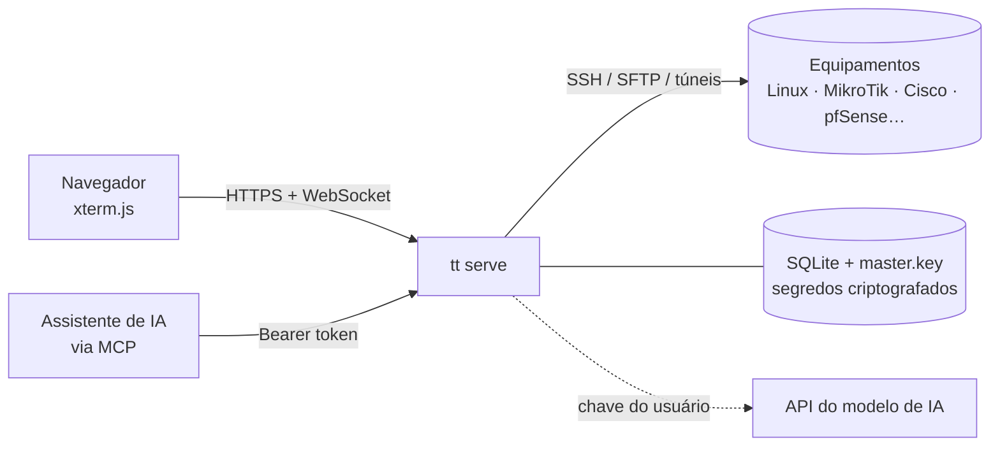

</details>

## Segurança

- Senhas de usuários com **Argon2id**; segredos de hosts com **XChaCha20-Poly1305** (chave mestra em `master.key`, permissão 0600).
- Sessão por cookie `HttpOnly` + `SameSite=Strict`; verificação de `Origin` em requisições que alteram estado e em WebSockets; bloqueio após 8 tentativas de login por IP.
- **Chave de host:** SFTP, túneis e MCP só conectam a hosts já confiados em um terminal.
- **IA:** segredos (senhas, chaves, `secret`, `snmp community`, PSK, tokens) são mascarados antes de sair; o texto da tela é tratado como dado não confiável; a chave de API nunca volta ao navegador; endereço de API personalizado só para administradores.
- **MCP:** só executa comandos de uma lista de leitura por equipamento; tokens `read` ou `exec`, guardados só como hash; tudo é auditado.
- **Túneis** escutam só em `127.0.0.1` do servidor (use `--allow-public-tunnels` para liberar outros endereços).

> [!WARNING]
> O TT fala HTTP simples. Para acesso pela rede coloque-o atrás de um proxy HTTPS (Caddy, nginx, Traefik) e use `--secure-cookies`. **Faça backup de `master.key` junto com `tt.db`**: sem a chave mestra os segredos salvos não são recuperáveis.

Relatos de vulnerabilidade: [SECURITY.md](SECURITY.md).

## Roadmap

- [x] Terminal, sessões, usuários, SFTP, perfis por equipamento, NETCONF
- [x] Túneis local e SOCKS5
- [x] Assistente de IA assistido e servidor MCP
- [x] Binários para Windows, Linux e macOS (Releases)
- [ ] Instalador desktop (Tauri / .msi) e ícone na área de trabalho
- [ ] Túnel remoto (`-R`), salto por bastion, multi-execução, macros
- [ ] TLS nativo, 2FA, gravação de sessões
- [ ] Telnet/serial, X11, RDP/VNC
- [ ] Upload em streaming, respostas da IA em streaming, tradução da interface

Detalhes em [docs/SPEC.md](docs/SPEC.md).

## Como ajudar

- **Teste em equipamento real** (MikroTik, Cisco, Huawei, Junos, pfSense, OPNsense, OpenWrt, Raspberry) e abra uma issue com o que funcionou ou falhou. Os comandos dos perfis vêm da documentação pública e **ainda não foram validados em hardware**.
- **Crie ou melhore perfis:** é só um arquivo JSON em `profiles/`.
- **Implemente algo do roadmap** ou traduza a interface.
- Regras de contribuição e a política clean-room: [CONTRIBUTING.md](CONTRIBUTING.md) e [docs/CLEAN-ROOM.md](docs/CLEAN-ROOM.md).

> Projeto *clean-room*: reimplementa **funcionalidades** de uma workstation SSH tradicional, sem copiar código, arte, nomes ou textos de nenhum software.

<details>
<summary><b>Configuração: dados, marca e novos equipamentos</b></summary>

**Dados.** Banco, chave mestra, perfis próprios e marca ficam em `--data` (ou `TT_DATA`, padrão `./tt-data`).

**Marca.** Crie `tt-data/branding.json`:

```json
{ "name": "Minha Marca", "tagline": "Ferramentas de campo", "accent": "#00a3ff", "logo": true }
```

e coloque `tt-data/logo.svg` (ou `.png`, `.webp`, `.jpg`). Para mudar o tema inteiro edite as variáveis em `ui/theme.css`.

**Novo tipo de equipamento.** Crie um JSON em `tt-data/profiles/` (ou envie um PR em `profiles/`) no formato dos existentes. Um perfil próprio com o mesmo `id` substitui o embutido.

</details>

## Licença

[MIT](LICENSE): use, modifique, troque a logo, distribua.
