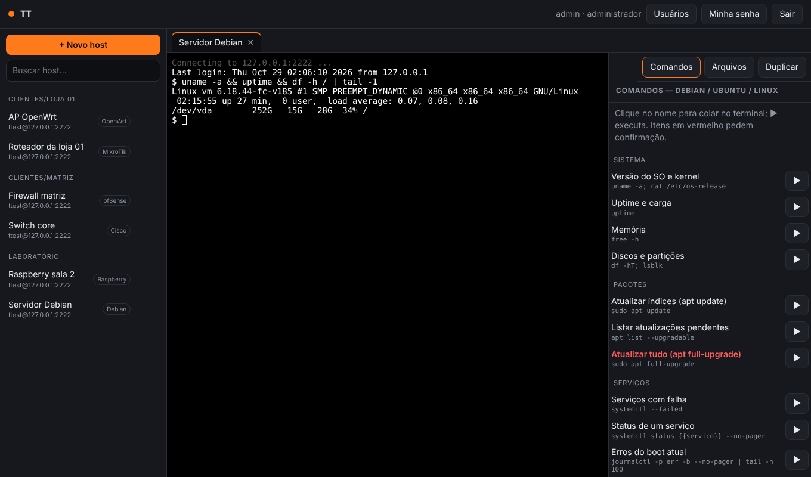
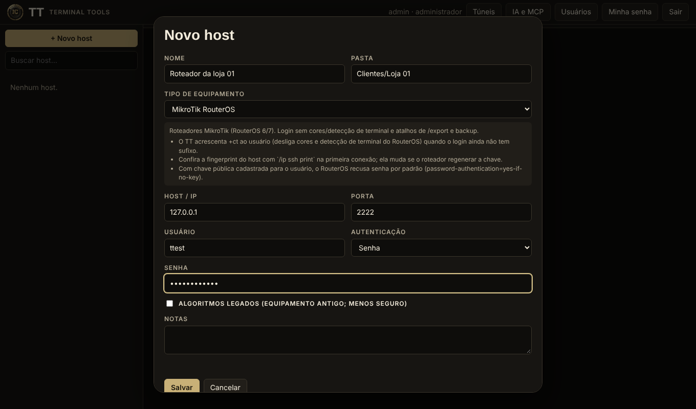
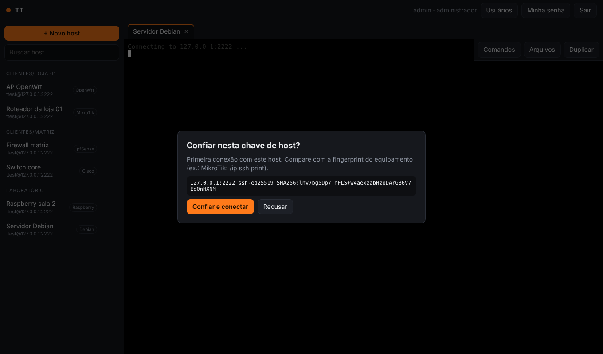
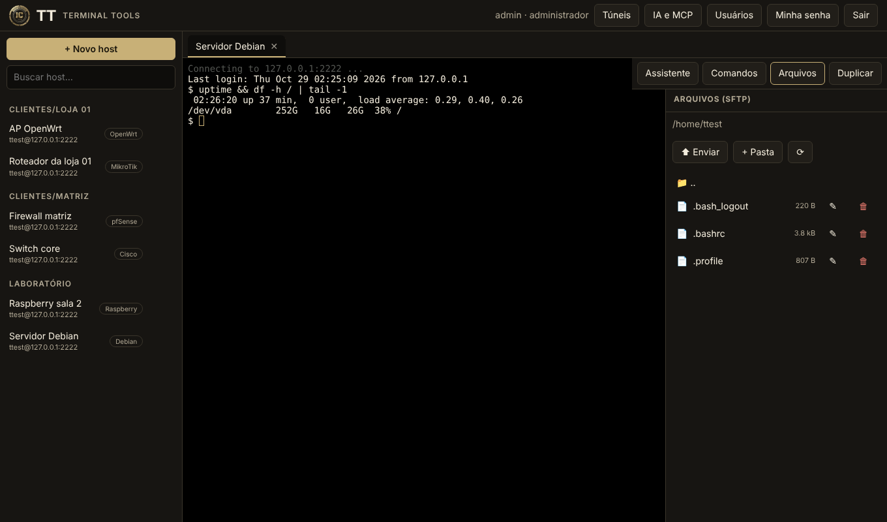
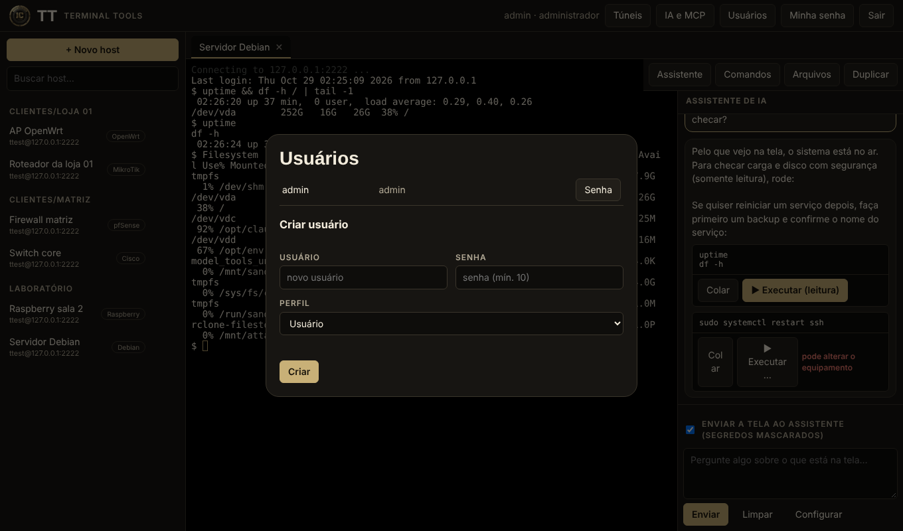
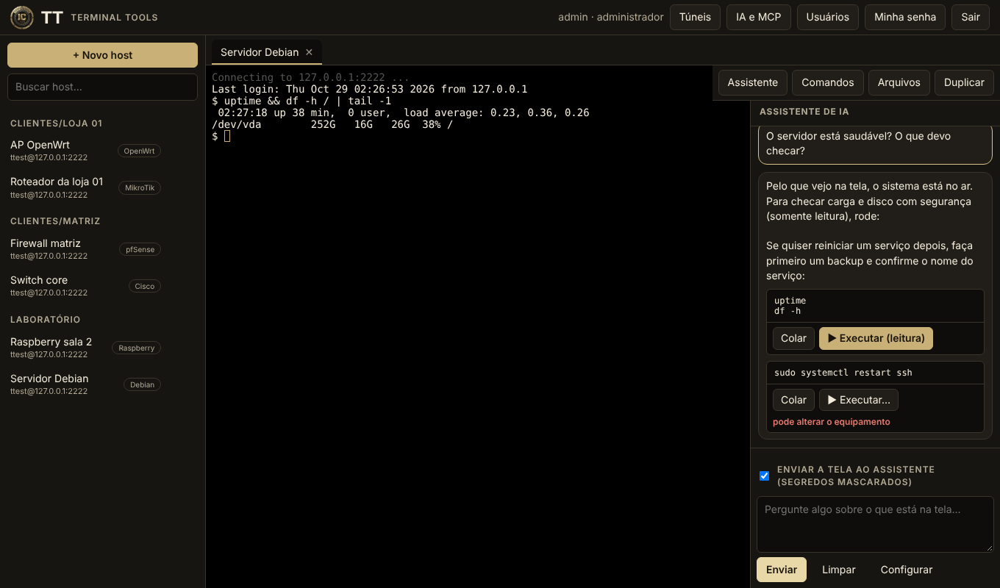
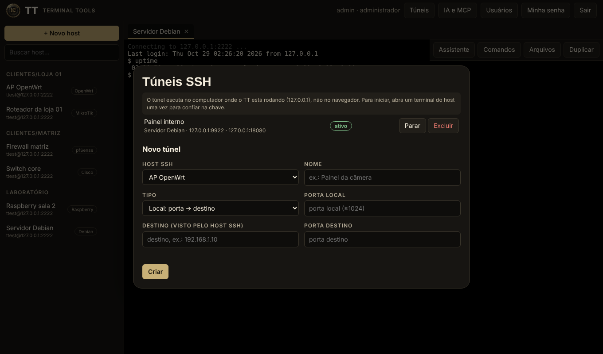
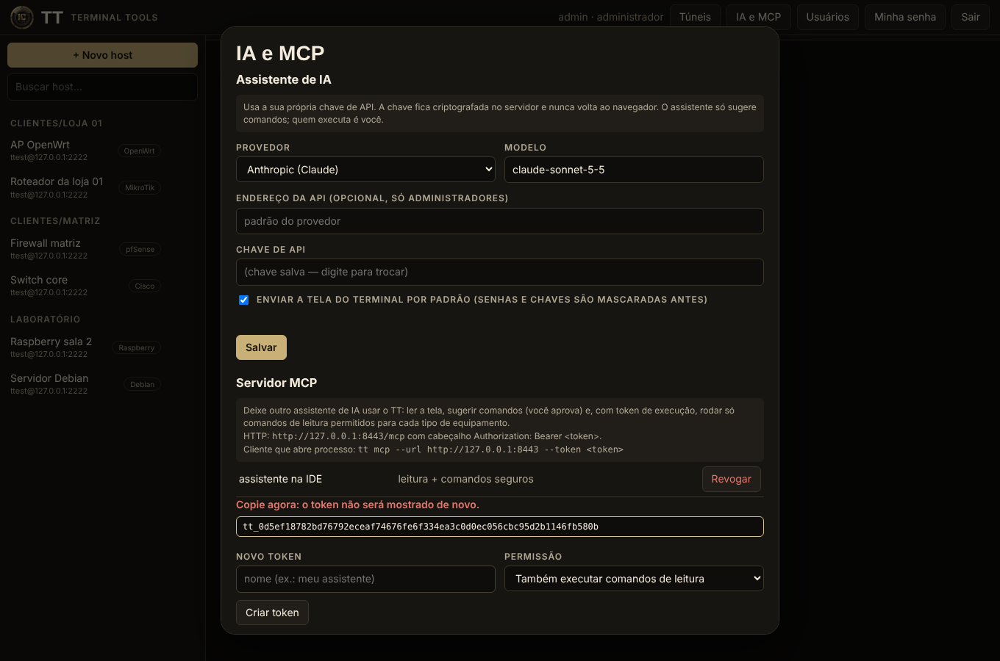

# TT — Terminal Tools

**Estação de trabalho SSH livre e aberta, para o técnico de campo, o analista de redes e o sysadmin — no seu computador ou acessada pela rede.**

> 🚧 **Em pleno desenvolvimento (v0.2).** O que está aqui já funciona, mas ainda falta muita coisa e **a comunidade é bem-vinda para ajudar**: testar em equipamentos reais, corrigir comandos, criar perfis, traduzir e implementar o roadmap. Veja [Como ajudar](#como-ajudar).



## Que dor o TT resolve

- **"Cada equipamento tem um jeito diferente de entrar."** MikroTik quer `+ct` no usuário, Cisco pede `terminal length 0` e `enable`, pfSense cai num menu e você precisa digitar `8`, OpenWrt não tem SFTP por padrão. O TT conhece essas manhas e já faz isso por você, por **tipo de equipamento**.
- **"Eu esqueço o comando."** Cada tipo traz comandos prontos e agrupados (diagnóstico, rede, firewall, backup…), com os perigosos marcados e pedindo confirmação.
- **"Minhas senhas e IPs estão espalhados em planilhas e no bloco de notas."** Sessões organizadas em pastas, com segredos **criptografados** — e acesso pela rede com **usuário e senha** para a equipe toda, cada um com seus próprios hosts.
- **"Preciso acessar de qualquer lugar, mas quem fala com os equipamentos é a máquina da rede interna."** No modo servidor, só o TT precisa alcançar os equipamentos; o técnico usa o navegador.
- **"As ferramentas boas são pagas ou fechadas."** O TT é **MIT**: use, modifique, ponha a sua logo, distribua.

## Para quem é

Técnicos de campo e integradores (CFTV, redes, segurança eletrônica), provedores e ISPs pequenos, times de TI de empresas, sysadmins e homelabbers, estudantes de redes. Se você abre SSH em Linux, roteadores, firewalls e switches no dia a dia, é para você.

## Dois modos, um programa

| Modo | Comando | Para quê |
|------|---------|----------|
| **Local** | `tt local` | Uso individual. Abre o navegador já logado (sem senha), escuta só em `127.0.0.1`. |
| **Servidor web** | `tt serve --bind 0.0.0.0:8443` | A sua máquina (ou um servidor) fala SSH com os equipamentos; o painel é acessado pela rede com **usuário e senha**. O primeiro acesso cria o **administrador**, que cria os demais usuários. |

## Telas

| | |
|---|---|
|  **Primeiro acesso:** cria o administrador |  **Cadastro por tipo de equipamento**, com avisos específicos |
|  **Confirmação da chave do host** (alerta forte se mudar) |  **Arquivos por SFTP** ao lado do terminal |
|  **Administração de usuários** |  **Assistente de IA** sugerindo comandos (resposta ilustrativa de um modelo simulado) |
|  **Túneis SSH** |  **IA e MCP:** chave própria e tokens |

## O que já funciona (v0.1)

- Terminal SSH no navegador (xterm.js), abas, redimensionamento; login por **senha, chave privada e keyboard-interactive**.
- **Verificação de chave do host** (confiar na primeira vez; alerta forte se a chave mudar).
- Gerenciador de sessões com pastas e busca; **segredos criptografados em repouso** (XChaCha20-Poly1305).
- **Gerenciador de arquivos SFTP** (listar, enviar, baixar, criar pasta, renomear, excluir).
- **Perfis de equipamento:** Debian/Ubuntu, Raspberry Pi, OpenWrt, pfSense, OPNsense, MikroTik, Cisco IOS/IOS-XE, Juniper Junos, Huawei VRP, NETCONF e genérico — veja [docs/PLATFORMS.md](docs/PLATFORMS.md).
- **Console NETCONF** (RFC 6241/6242, framing 1.0 e 1.1).
- Usuários e administrador, senhas com Argon2id, limite de tentativas de login, proteção contra requisições cross-site.
- **Túneis SSH:** encaminhamento local (porta → destino) e proxy **SOCKS5** dinâmico, com início/parada pelo painel.
- **Assistente de IA** ao lado do terminal: lê a tela (segredos mascarados antes de sair), explica e **sugere** comandos e boas práticas com a **sua** chave de API. Nunca executa sozinho.
- **Servidor MCP** (HTTP e stdio): outro assistente de IA pode ler a tela, sugerir comandos (você aprova) e rodar comandos de **leitura** permitidos por tipo de equipamento, com tokens pessoais e auditoria. Veja [docs/AI-AND-MCP.md](docs/AI-AND-MCP.md) e a [skill](skill/tt-network-assistant/SKILL.md).
- Visual escuro com dourado, com marca personalizável (nome, cor, logo) por arquivo, sem recompilar.

## O que ainda falta (roadmap)

Túnel remoto (`-R`), multi-execução, macros, salto por bastion, gestão de chaves, TLS nativo e 2FA, gravação de sessões, telnet/serial, X11, RDP/VNC **app desktop empacotado**, upload em streaming, respostas da IA em *streaming* e tradução da interface. Detalhes em [docs/SPEC.md](docs/SPEC.md) e [docs/AI-AND-MCP.md](docs/AI-AND-MCP.md).

## Como ajudar

- **Teste em equipamento real** (MikroTik, Cisco, Huawei, Junos, pfSense, OPNsense, OpenWrt, Raspberry) e abra uma issue dizendo o que funcionou ou falhou. Os comandos dos perfis foram escritos pela documentação pública e **ainda não foram validados em hardware**.
- **Crie ou melhore perfis de equipamento:** é só um arquivo JSON em `profiles/`.
- **Implemente algo do roadmap** ou traduza a interface.
- **Aviso de segurança?** Veja [SECURITY.md](SECURITY.md). Regras de contribuição e a política clean-room: [CONTRIBUTING.md](CONTRIBUTING.md) e [docs/CLEAN-ROOM.md](docs/CLEAN-ROOM.md).

> Projeto *clean-room*: reimplementa **funcionalidades** de uma workstation SSH tradicional, sem copiar código, arte, nomes ou textos de nenhum software.

## Rodando

```bash
cargo run --release -- local                       # modo local
cargo run --release -- --data ./tt-data serve      # modo servidor em 127.0.0.1:8443
```

Dados (banco, chave mestra, perfis próprios, marca) ficam em `--data` (ou `TT_DATA`). **Faça backup de `master.key` junto com `tt.db`**: sem a chave mestra os segredos salvos não são recuperáveis.

### Expondo na rede com segurança

O TT fala HTTP simples. Túneis escutam só em `127.0.0.1` do servidor (use `--allow-public-tunnels` para liberar outras interfaces). Para acesso pela rede coloque-o atrás de um proxy HTTPS (Caddy, nginx, Traefik) e use `--secure-cookies`. O TT avisa quando escuta fora do loopback sem isso.

### Personalizando a marca

Crie `tt-data/branding.json`:

```json
{ "name": "Minha Marca", "tagline": "Ferramentas de campo", "accent": "#00a3ff", "logo": true }
```

e coloque `tt-data/logo.svg` (ou `.png`, `.webp`, `.jpg`). Para mudar todo o tema edite as variáveis em `ui/theme.css`.

### Adicionando um tipo de equipamento

Crie um JSON em `tt-data/profiles/` (ou envie um PR em `profiles/`) no formato dos arquivos existentes. Perfis próprios com o mesmo `id` substituem os embutidos.

## Segurança em resumo

Senhas de usuários: Argon2id. Segredos de hosts: XChaCha20-Poly1305 com chave mestra em `master.key` (0600). Sessão por cookie `HttpOnly` + `SameSite=Strict`, verificação de `Origin` em requisições que alteram estado e em WebSockets, bloqueio após 8 tentativas de login por IP. SFTP, túneis e o MCP só conectam a hosts cuja chave já foi confiada em um terminal. Segredos são mascarados antes de irem para a IA; o MCP só executa comandos de uma lista de leitura por tipo de equipamento. Relatos de vulnerabilidade: veja [SECURITY.md](SECURITY.md).

## Licença

MIT — use, modifique, troque a logo, distribua. Veja [LICENSE](LICENSE).
